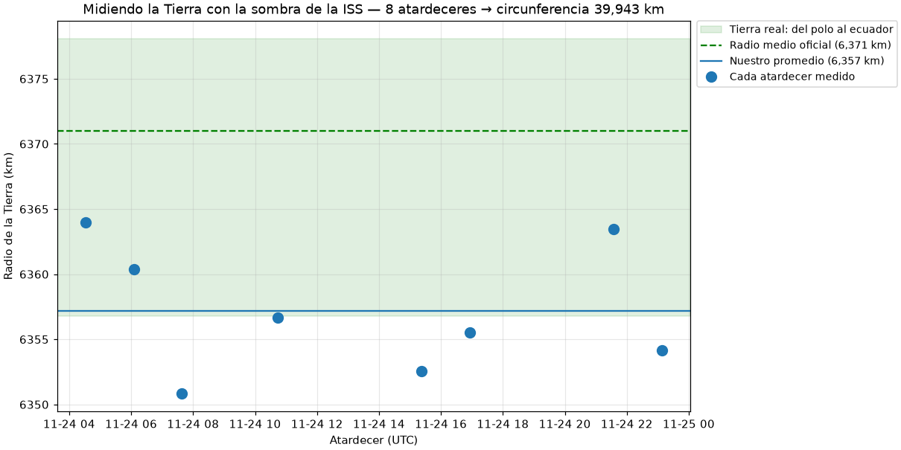
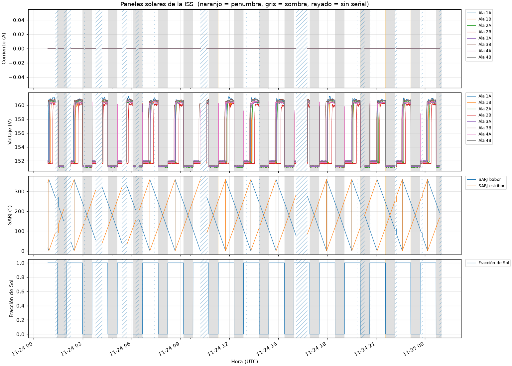
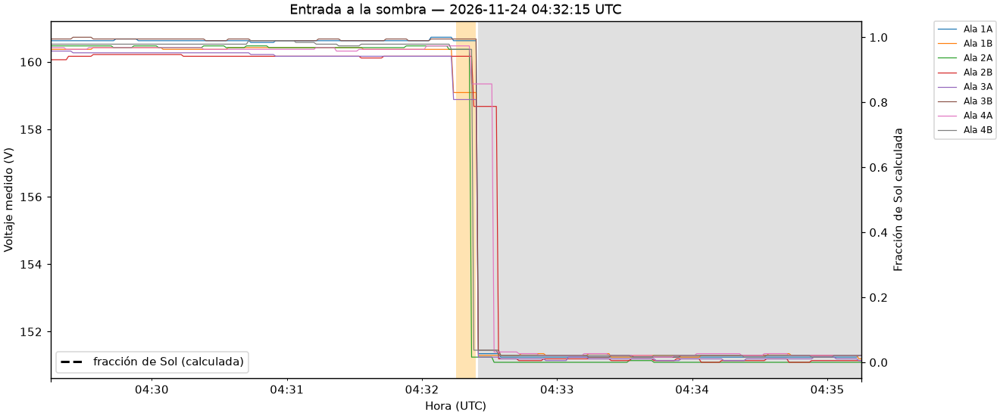
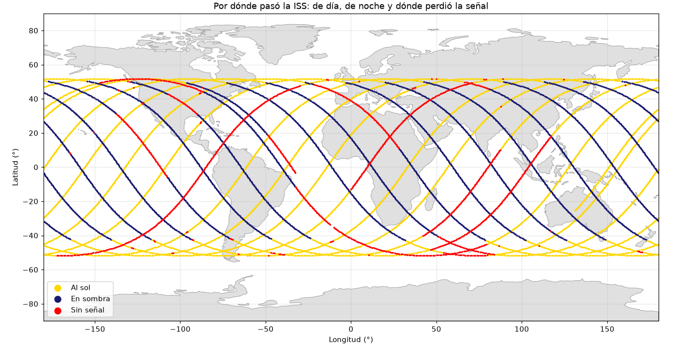

# 🛰️ Midiendo la Tierra con los paneles solares de la ISS

Grabamos durante 24 horas la telemetría **pública y en vivo** de los paneles
solares de la Estación Espacial Internacional (ISS) y, usando solo el momento en
que sus paneles "ven ponerse el Sol", **medimos la circunferencia de la Tierra**.

> **Resultado:** radio **6.357 ± 5 km** → circunferencia **39.943 km**
> (valor oficial: 40.030 km, diferencia **0,2 %**), con 8 atardeceres.

Es la idea de Eratóstenes (medir la Tierra con sombras, ~240 a.C.), pero
usando la sombra de la Tierra sobre una estación espacial.



---

## Cómo funciona

1. **Grabamos** los 26 sensores de los paneles (voltaje, corriente y ángulos de
   las 8 alas y de las 2 juntas rotatorias SARJ), una vez por segundo, desde el
   servidor público *ISS Live* de la NASA.
2. **Calculamos** con mecánica orbital (órbita TLE + efemérides JPL) dónde está la
   ISS y qué fracción del Sol ve: **sol**, **penumbra** (~9 s) o **sombra** (~35 min).
3. **Detectamos el atardecer real:** cuando la ISS entra a la sombra, el voltaje de
   los paneles cae de golpe de ~160 V a ~151 V.
4. **Buscamos el radio de Tierra** que hace coincidir el atardecer calculado con el
   medido. Una Tierra más grande hace sombra *antes*: cada segundo de diferencia
   equivale a ~2,5 km de radio.

## Qué encontramos en 24 horas

| Dato | Valor |
|---|---|
| Filas grabadas | 86.905 (99,96 % de los segundos) |
| Órbitas | ~15,5 (una cada ~93 min) |
| Atardeceres | 16 (8 con señal completa → usados para medir) |
| Tiempo sin señal | 14,4 % (50 cortes, ~4 min cada uno) |
| Retraso de la telemetría | 3,1 s (medido y descontado) |
| Voltaje al sol / en sombra | ~160 V / ~151 V |

### Un día completo
Cada bloque gris es una pasada por la sombra de la Tierra. El voltaje sube por
escalones: **cada ala llega a 160 V cuando sus baterías terminan de cargarse**,
y cae de golpe al entrar a la sombra.



### Un atardecer de cerca
En naranjo, los 9 segundos de penumbra. Las alas caen en dos escalones y
terminan de caer justo cuando el Sol queda completamente oculto.



### Dónde se pierde la señal
La ISS no transmite directo a la Tierra, sino a través de satélites repetidores
(TDRS). En rojo, los tramos sin cobertura: ahí los datos se congelan y los
descartamos.



## ¿Por qué no da exactamente 6.371 km?

- **La Tierra es achatada:** mide 6.357 km de radio en los polos y 6.378 km en el
  ecuador. En nuestros atardeceres la sombra "roza" la Tierra cerca de los 43°
  de latitud, donde el radio real es **~6.368 km**.
- **¿Cuándo cuenta como atardecer?** Definimos el atardecer como el momento en
  que queda la *mitad* del Sol. Pero los datos muestran que el voltaje cae cuando
  el Sol ya está casi completamente oculto: el sistema eléctrico aguanta hasta el
  último rayo. Si definimos el atardecer como "Sol totalmente oculto", el radio
  medido sube a **6.368 km**, que coincide con el radio local esperado.

| Definición de atardecer | Radio medido | Circunferencia |
|---|---|---|
| Queda la mitad del Sol (por defecto) | 6.357 km | 39.943 km |
| Queda un cuarto del Sol | 6.362 km | 39.972 km |
| Sol totalmente oculto | 6.368 km | 40.009 km |

Esto es una **prueba de sensibilidad**, no un ajuste: muestra que la mayor fuente
de incertidumbre no es la medición, sino saber *con cuánta luz* reacciona el
sistema eléctrico de la ISS.

## Limitaciones honestas

- **Corrientes:** los sensores públicos de corriente ("Drive Current") marcan 0
  siempre; usamos el voltaje, que mide indirectamente el estado del sistema.
- **Muestreo:** 1 fila por segundo → ±1 s ≈ ±2,5 km por atardecer.
- **Órbita:** usamos el TLE más reciente; para datos de hace muchos días habría
  que usar el TLE de esa fecha.
- **Atmósfera:** su efecto (la sombra "real" es un poco más grande) queda mezclado
  con el punto anterior; separar ambos efectos necesitaría más datos.

---

## Archivos

| Archivo | Qué hace |
|---|---|
| `sensores.py` | Lista de sensores (código NASA → nombre legible) |
| `posicion_iss.py` | Posición de la ISS y fracción de Sol visible (sol / penumbra / sombra) |
| `grabar_paneles.py` | Se conecta a la ISS y escribe 1 fila por segundo en `datos/` |
| `graficar.py` | Estadísticas y gráficos (`--guardar` → PNG en `graficos/`) |
| `medir_tierra.py` | Mide el radio y la circunferencia de la Tierra |
| `instalar_servidor.sh` | Instala el grabador como servicio 24/7 en Ubuntu |
| `datos/*.csv.gz` | Las 24 h grabadas (comprimidas; se leen sin descomprimir) |

### Columnas de los datos

`hora_utc, latitud, longitud, altitud_km, fraccion_sol, estado_luz, con_senal, retraso_s,`
y luego voltaje, corriente y ángulo beta de las 8 alas, y los 2 ángulos SARJ.

## Reproducir el análisis

```bash
python3 -m venv .venv
source .venv/bin/activate
pip install -r requirements.txt
python graficar.py --guardar
python medir_tierra.py --guardar
```

## Grabar tus propios datos

En tu computador: `python grabar_paneles.py` (Ctrl + C para detener).

En un servidor Ubuntu, para que grabe siempre:

```bash
bash instalar_servidor.sh
journalctl -u iss-paneles -f      # ver el log en vivo
```

Usa ~25 MB por día (sin comprimir).

## Créditos

- Telemetría: NASA *ISS Live* (servidor público Lightstreamer `push.lightstreamer.com`, adapter `ISSLIVE`).
- Códigos de sensores: proyecto [ISS Mimic](https://github.com/ISS-Mimic/Mimic) (`Telemetry/ISS_Public_Telemetry.xlsx`).
- Órbita: TLE de [CelesTrak](https://celestrak.org); efemérides JPL DE421 vía [Skyfield](https://rhodesmill.org/skyfield/).
- Contornos de los continentes: [Natural Earth](https://www.naturalearthdata.com) 1:110m (dominio público), en `mapa/`.
